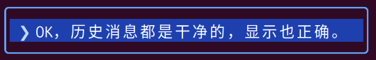

# user-message-card

A [Claude Code](https://claude.com/claude-code) interface mod: your own prompts render as a **blue rounded card with white text and a `❯` marker**, so user input is instantly distinguishable from Claude's plain-text replies.

[Claude Code](https://claude.com/claude-code) 界面 mod：你自己输入的消息渲染为**蓝色圆角卡片——白字、左侧 `❯` 标记**，让用户输入与 Claude 的纯文本回复一眼可辨。



*Your own prompt wrapped in the blue card; assistant replies keep their default styling.*
*用户消息被蓝色卡片包裹；助手回复保持默认样式。*

## What it does / 作用

- **Composer input** — messages you type at the terminal (`composer` origin).
- **Composer 输入** —— 你在终端输入的消息（`composer` 来源）。
- **Remote Control input** — messages sent from phone/web clients (`bridge` origin).
- **Remote Control 输入** —— 从手机/Web 客户端发来的消息（`bridge` 来源）。

Everything else keeps the engine's own drawing: background task notifications, messages from other sessions or channels, and plugin-authored rows.

其他消息保持引擎默认渲染：后台任务通知、其他会话或频道转发的消息、插件产生的行。

The mod is **display-only** — it never rewrites message text. The stored transcript and everything the model reads remain exactly as typed. In the full-transcript view (ctrl+o), `--verbose` mode and exports, user messages also stay verbatim; the card appears only in the everyday interactive view.

本 mod **只做显示**，不改写任何消息文本。存储的对话记录和模型读到的内容完全不变。在完整记录视图（ctrl+o）、`--verbose` 模式及导出中，用户消息保持原始面貌；卡片只出现在日常交互视图里。

## Colors / 配色

| Part 部分 | Color 颜色 |
|---|---|
| Card background / 卡片底色 | `#1e40af` |
| Rounded border / 圆角边框 | `#60a5fa` |
| `❯` marker / 标记 | `#bfdbfe` (bold) |
| Message text / 正文白字 | `#ffffff` |

## Install / 安装

At the prompt of a Claude Code terminal session (2.1.275+), type:

在 Claude Code 终端会话的提示符输入（2.1.275+）：

```
/plugin install user-message-card --marketplace jason2000wh/user-message-card
```

Or from a shell / 或从命令行：

```sh
claude plugin install user-message-card --marketplace jason2000wh/user-message-card
```

Answer `y` to add the marketplace, choose the **user** scope, and the mod is active immediately — no restart.

输入 `y` 确认添加 marketplace，选择 **user** 作用域，mod 立即生效，无需重启。

> A truecolor-capable terminal is recommended for the exact hex colors; otherwise colors degrade gracefully.
> 精确显示 hex 颜色需要支持 truecolor 的终端；不支持时颜色会优雅降级。

## Manual install / 手动安装

Copy this folder to the machine, then:

将本文件夹拷到目标机器后：

```sh
claude plugin marketplace add ./user-message-card
claude plugin install user-message-card
```

Or try it without installing / 或不安装直接试用：

```sh
claude --plugin-dir ./user-message-card
```

## Customize / 自定义

Edit the hex values (or border style) in `hooks/register.tsx` and reload. While developing with `--plugin-dir`, saving the file hot-reloads the mod; an installed copy updates through `claude plugin update` then `/reload-plugins`.

修改 `hooks/register.tsx` 中的 hex 值（或边框样式）后重载。用 `--plugin-dir` 开发时保存即热加载；安装版走 `claude plugin update` 再 `/reload-plugins`。

## Files / 文件

| File | Purpose |
|---|---|
| `.claude-plugin/plugin.json` | Plugin manifest / 插件清单 |
| `hooks/hooks.json` | Hook registration / 钩子注册 |
| `hooks/register.tsx` | The single `ui.render` hook / 唯一的渲染钩子 |
| `tests/render.test.tsx` | 12 render tests / 12 条渲染测试 |
| `docs/screenshot.png` | README screenshot / README 截图 |

## License

[MIT](LICENSE)
